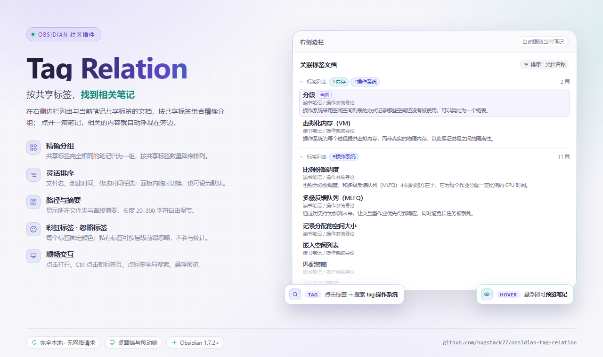

# Tag Relation

An Obsidian plugin that adds a right sidebar panel listing the notes that **share tags** with the current note, grouped by the exact set of shared tags.

[中文说明](#中文说明) · [Releases](https://github.com/bugstack27/obsidian-tag-relation/releases)

## Features

- **Grouped by shared tags** — notes sharing exactly the same tags are grouped together; groups are ordered by the number of shared tags (descending), then by tag name.
- **Sort within a group** — by file name, creation time, or modification time (newest first). The panel title bar can switch the sort temporarily for that panel only; use **Set as default sort** in the menu, or change it in the settings tab, to persist it.
- **Path and summary** — optionally show the folder path of each note, and its first paragraph as a brief summary (20–300 characters).
- **Rainbow tags** — a stable color per tag name, inside this plugin's panel only.
- **Ignored tags** — tags on the ignore list take no part in the relation statistics: they are never a shared tag and never shape a group, exactly as if the tag did not exist. Hierarchy prefixes are supported, so `private` also ignores `private/secret`; matching is case-insensitive and accepts names with or without `#`.
- **Interaction** — click a note to open it, `Ctrl`/`Cmd`-click or middle-click to open it in a new tab, click a tag to search `tag:name` in global search, and hover a note to preview it when the core **Page preview** plugin is enabled.
- **Empty states that explain themselves** — the panel distinguishes "the current note has no tags", "all of its tags are ignored", and "its tags are not shared with any other note".

## Installation

Install through [BRAT](https://github.com/TfTHacker/obsidian42-brat):

1. In **Settings → Community plugins**, turn off restricted mode, then install and enable **BRAT**.
2. Open the **BRAT** settings and choose **Add beta plugin**.
3. Enter the repository: `bugstack27/obsidian-tag-relation`
4. Confirm, wait for BRAT to fetch the latest release, then enable **Tag Relation** in **Settings → Community plugins**.

Manual install: download `main.js`, `manifest.json` and `styles.css` from [Releases](https://github.com/bugstack27/obsidian-tag-relation/releases), put them in `<vault>/.obsidian/plugins/tag-relation/`, restart Obsidian and enable the plugin.

> BRAT installs a published release. If the release is still a draft, publish it first.

## Usage

After enabling, the plugin opens the **Tag relation** panel in the right sidebar. You can also run **Open tag relation panel** from the command palette, or click the ribbon icon.

1. Open a note that has tags.
2. Read the groups of notes sharing those tags in the right sidebar.
3. Click a note to jump to it, or click a tag to search for related content.

## Settings

| Setting            | Default   | Description                                            |
| ------------------ | --------- | ------------------------------------------------------ |
| Show path          | On        | Show the folder path next to each related note         |
| Show summary       | On        | Show the first paragraph of each related note          |
| Summary length     | 80        | Maximum number of characters (20–300)                  |
| Sort within group  | File name | File name, creation time, or modification time         |
| Rainbow tag colors | Off       | Generate a stable color per tag name                   |
| Ignored tags       | Empty     | One tag per line, hierarchy prefixes, case-insensitive |

Settings are stored in the plugin's `data.json` and are searchable in Obsidian's settings search (Obsidian 1.13.0 and later).

## Privacy and data access

- **Fully local.** The plugin makes no network requests, collects no telemetry, and talks to no third-party service. Nothing leaves your device.
- **Vault enumeration.** "Shares a tag with the current note" is a whole-vault question: to answer it, the plugin enumerates the paths of every Markdown file in the vault (`vault.getMarkdownFiles()`) on each refresh, and reads the tags of those files from Obsidian's in-memory metadata cache. This is the reason the plugin can see every file path in your vault — the enumeration is limited to that comparison, and only Markdown notes are considered.
- **What is read.** Tags come from the metadata cache, not from the note bodies. Note bodies are read only for the notes the panel actually lists, and only when **Show summary** is on, to render the first paragraph of each of them.
- **What is written.** Only the plugin's own `data.json`. The plugin never writes to, renames, moves, or deletes your notes, and never reads outside the vault.
- **Scope.** Non-Markdown files are skipped entirely; attachments are never opened.

## Compatibility

- Obsidian 1.7.2 and later.
- Desktop and mobile.
- Hover previews need the core **Page preview** plugin (it works automatically once enabled).
- Settings use the declarative settings API on Obsidian 1.13.0 and later, and fall back to the classic settings tab on older versions.

## Development

```bash
npm install     # install dependencies
npm run dev     # watch mode, writes main.js
npm run build   # type check + production build
npm run lint    # ESLint
```

Source lives in `src/`; the build output is `main.js` (not committed).

For local debugging, copy `main.js`, `manifest.json` and `styles.css` into `<vault>/.obsidian/plugins/tag-relation/` and reload Obsidian.

## Release

```bash
npm version patch   # updates package.json, manifest.json, versions.json and tags the commit
git push --follow-tags
```

Pushing the tag makes GitHub Actions run the type check and build, then create a draft release with `main.js`, `manifest.json`, `styles.css` and build provenance. Review it and publish the release manually.

## License

[0-BSD](LICENSE)

***

## 中文说明

### 功能

- **按共享标签分组**：共享标签完全相同的笔记归为一组；分组按共享标签数量降序排列，再按标签名排序。
- **组内排序**：可选文件名称、创建时间、修改时间（时间均为新的在前）。面板标题栏可临时切换排序，只影响当前面板、不写回设置；想改默认时在菜单里选「设为默认排序」，或直接到设置页修改。
- **显示路径 / 摘要**：可显示笔记所在文件夹，以及在笔记下方显示首段内容作为简要信息，摘要长度可调（20–300 字符）。
- **彩虹标签**：按标签名生成稳定的颜色，不同标签显示不同颜色，仅影响本插件面板。
- **忽略标签**：被忽略的标签不参与关联统计，既不作为共享标签，也不参与分组，等同于该标签不存在。支持层级前缀匹配，例如配置 `private` 会同时忽略 `private/secret`；匹配不区分大小写，带不带 `#` 均可。
- **交互**：点击笔记打开，`Ctrl`/`Cmd` 点击或鼠标中键在新标签页打开；点击标签跳转到全局搜索的 `tag:标签名`；安装并启用核心插件 **Page preview** 后可悬浮预览笔记。
- **空状态说明**：面板会区分「当前笔记没有标签」「标签被全部忽略」「标签未与其他笔记共享」三种情况，并给出对应提示。

### 安装

本插件通过 [BRAT](https://github.com/TfTHacker/obsidian42-brat) 安装。

1. 在 **设置 → 第三方插件** 中关闭安全模式，安装并启用 **BRAT**。
2. 打开 **BRAT** 的设置，选择 **Add Beta plugin**。
3. 填入仓库地址：
   ```
   bugstack27/obsidian-tag-relation
   ```
4. 确认并等待 BRAT 拉取最新 Release，然后在 **设置 → 第三方插件** 中启用 **Tag Relation**。

手动安装：从 [Releases](https://github.com/bugstack27/obsidian-tag-relation/releases) 下载 `main.js`、`manifest.json`、`styles.css`，放入 `<库>/.obsidian/plugins/tag-relation/`，重启 Obsidian 后启用。

> BRAT 安装的是已发布的 Release。如果 Release 仍是 draft，需要先手动发布。

### 使用

启用后，插件会在右侧边栏打开「标签关系」面板，也可以在命令面板执行 **打开标签关系面板**，或点击左侧功能区图标。

1. 打开一篇带标签的笔记。
2. 在右侧查看共享标签的笔记分组。
3. 点击笔记逐个跳转，或点击某个标签直接搜索同类内容。

### 设置

| 设置项      | 默认值  | 说明                   |
| -------- | ---- | -------------------- |
| 显示路径     | 开    | 在关联笔记旁显示所在文件夹路径      |
| 显示简要信息   | 开    | 在关联笔记下方显示首段内容        |
| 简要信息长度   | 80   | 摘要最多显示的字符数（20–300）   |
| 组内排序     | 文件名称 | 可选文件名称、创建时间、修改时间     |
| 标签使用彩虹颜色 | 关    | 按标签名生成稳定颜色           |
| 忽略标签     | 空    | 每行一个标签，支持层级前缀，不区分大小写 |

设置保存在插件的 `data.json` 中；Obsidian 1.13.0 及以上版本会把它们编入设置搜索。

### 隐私与数据访问

- **完全本地运行**，**不发起任何网络请求**，不收集、不上传任何数据，不与任何第三方服务通信。
- **会枚举库内文件**：「与当前笔记共享标签」是一个需要看全库的问题，所以面板每次刷新都会枚举库中所有 Markdown 笔记的路径（`vault.getMarkdownFiles()`），并从 Obsidian 的内存元数据缓存里读取这些笔记的标签。这就是本插件能看到库内全部文件路径的原因——枚举只用于这次比对，且只涉及 Markdown 笔记。
- **读什么**：标签来自元数据缓存，不读正文。只有在开启「显示简要信息」时，才会读取面板实际列出的那几篇笔记的首段文本，用于展示。
- **写什么**：只写插件自己的 `data.json`。不会修改、重命名、移动或删除笔记，不会读取库外的文件。
- **范围**：非 Markdown 文件一律跳过，附件不会被打开。

### 兼容性

- Obsidian `1.7.2` 及以上。
- 桌面端与移动端均可使用。
- 面板的悬浮预览依赖核心插件 **Page preview**（开启后自动生效）。
- 设置页在 Obsidian 1.13.0 及以上使用声明式设置（可被设置搜索检索），更早的版本回退到经典设置页。

### 开发

```bash
npm install     # 安装依赖
npm run dev     # 监听编译，生成 main.js
npm run build   # 类型检查 + 生产构建
npm run lint    # ESLint 检查
```

源码位于 `src/`，构建产物为 `main.js`（不纳入版本控制）。

本地调试时，把 `main.js`、`manifest.json`、`styles.css` 复制到 `<库>/.obsidian/plugins/tag-relation/`，重载 Obsidian 即可。

### 发布

```bash
npm version patch   # 同步更新 package.json、manifest.json、versions.json，并打 tag
git push --follow-tags
```

推送 tag 后，GitHub Actions 会执行类型检查与构建，生成 `main.js`、`manifest.json`、`styles.css` 的 Release（draft），并记录构建证明。确认无误后手动发布该 Release。

### 许可

[0-BSD](LICENSE)
